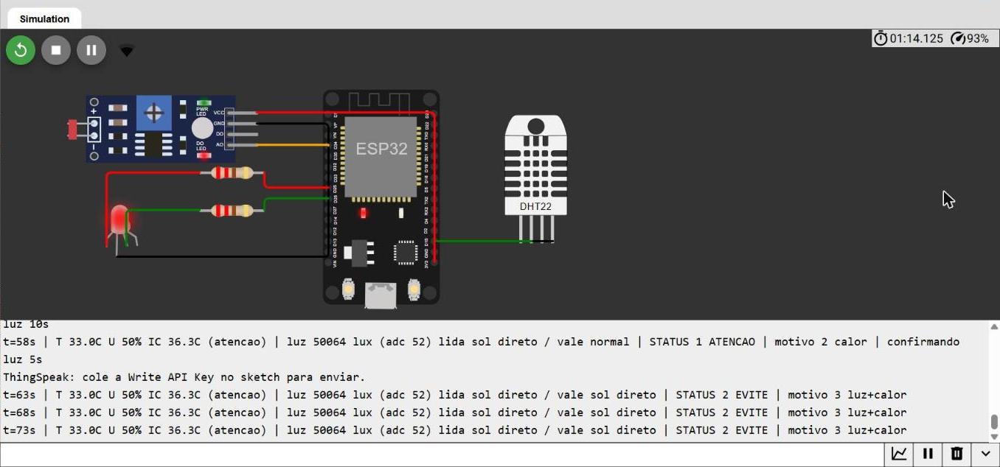

# C.E.L.I.A.

**Luz, calor e buracos na calçada perto de pontos de ônibus, em uma leitura rápida.**

Protótipo de acessibilidade urbana desenvolvido para a **Global Solution 2026.2 da FIAP**, no tema CitizenTech. A proposta é instalar módulos em postes perto de pontos de ônibus no Rio de Janeiro para ajudar pessoas com deficiência física ou mobilidade reduzida a escolher por onde passar.

[Abrir a simulação no Wokwi](https://wokwi.com/projects/481054670710338561) · [Ver o canal público no ThingSpeak](https://thingspeak.mathworks.com/channels/3577155) · [Seguir o roteiro da demonstração](edge/ROTEIRO_DEMO.md)



*Poste no Wokwi (18/11). Com 50.000 lux (sol direto) e 33 °C, o LED fica vermelho e o serial mostra EVITE, motivo luz e calor.*

## Como o poste decide

1. **Mede a cada 5 s.** O DHT22 mede temperatura e umidade para calcular o índice de calor. O LDR mede a luz em lux.
2. **Confirma uma mudança na luz.** A nova faixa de luz precisa persistir por 15 s na demonstração ou 60 s no modo normal. A sombra de um ônibus ou o farol de um carro passando não mudam o trecho.
3. **Mostra e publica o status.** O ESP32 acende o LED no local e escreve uma linha no monitor serial. Uma tarefa de rede envia a última leitura disponível ao ThingSpeak e espera 20 s após o fim de cada tentativa. O poste continua avaliando o trecho durante a espera pela rede.
4. **Ouve a câmera.** Se a câmera do poste vê um buraco, a API de visão avisa por MQTT e o trecho fica em Evite (motivo 5) por um tempo.

| LED | Status | Quando aparece |
| --- | --- | --- |
| 🟢 Verde | **0 · Acessível** | Luz normal (ou sol) e calor normal |
| 🟡 Amarelo | **1 · Atenção** | Rua escura, ou calor elevado sem sol direto |
| 🔴 Vermelho | **2 · Evite** | Sol direto com calor elevado, ou buraco visto pela câmera |

A rua conta como **escura abaixo de 10 lux** e como **sol direto a partir de 25.000 lux**. Para o índice de calor, a atenção começa em **32 °C** e o protótipo usa **41 °C** para perigo. A tabela completa está em [`edge/README.md`](edge/README.md).

## Experimente

1. Abra o [projeto no Wokwi](https://wokwi.com/projects/481054670710338561) e inicie a simulação. Para rodar exatamente a versão deste repositório, use os arquivos de [`edge/`](edge/).
2. Comece com o módulo de luz em **500 lux** e o DHT22 a **26 °C** e **50%** de umidade: o LED fica verde.
3. Mude a luz para **5 lux**. Quando a mudança for confirmada (15 s), o LED fica amarelo e o serial mostra `motivo 1 luz`.
4. Com a temperatura em **33 °C** e a luz em **50.000 lux**, o LED fica vermelho: sol direto com calor. O passo a passo completo está no [roteiro](edge/ROTEIRO_DEMO.md).
5. Para acompanhar os envios, veja o [guia do ThingSpeak](edge/THINGSPEAK.md). A demonstração local funciona sem uma chave de escrita.

## O que já foi validado

- **Poste no Wokwi (18/11).** Com Wi-Fi e MQTT conectados, o poste passou por luz normal (verde), rua escura (amarelo, motivo luz), calor (amarelo, motivo calor) e sol direto com calor (vermelho, motivo luz e calor), e a mudança de luz levou 15 s para valer. Os valores de lux e ADC bateram com os testes no computador. [Prints e detalhes](edge/evidencias/LEIA-ME.md)
- **Testes no computador.** 83 verificações das regras e 77 do firmware inteiro, com sensores, Wi-Fi, ThingSpeak e MQTT simulados: os campos de cada envio (luz no field7), DHT22 falhando, Wi-Fi caindo, ThingSpeak lento e buraco avisado pela câmera. Todas passando.
- **ThingSpeak.** O envio foi testado com registros reais no [canal público](https://thingspeak.mathworks.com/channels/3577155). O que vai em cada campo está no [guia do ThingSpeak](edge/THINGSPEAK.md).

## Câmera do poste (exemplo)

A foto da calçada vem de uma câmera no próprio poste (ESP32-CAM). Ela funciona pela rede local, por endereço IP, então não fica ligada para mostrar ao vivo. O repositório traz o código e a explicação de como funciona:

1. A câmera tira uma foto da calçada a cada 20 s e manda para a API de visão do João, com uma chave no cabeçalho (HU-23, RF22, RNF11).
2. A API procura buracos na foto.
3. Se achar um buraco, avisa o poste por MQTT, no tópico `celia/poste01/camera`.
4. O poste fica vermelho: EVITE, motivo 5 (HU-07).

Uma segunda montagem, presa numa cadeira de rodas, salva fotos de calçadas no cartão para treinar o modelo de buracos (HU-06). A explicação completa, um exemplo do que aparece no monitor serial e os programas estão em [`camera/`](camera/README.md).

## Código e testes

| Caminho | Conteúdo |
| --- | --- |
| [`edge/`](edge/README.md) | Poste no Wokwi: como funciona, circuito, campos do ThingSpeak e limitações |
| [`edge/sketch.ino`](edge/sketch.ino) | Firmware do ESP32: DHT22, LDR, LED, envio ao ThingSpeak e câmera por MQTT |
| [`edge/celia_logica.h`](edge/celia_logica.h) | Regras: luz em lux, faixas de luz e calor, status, motivo e confirmação |
| [`edge/diagram.json`](edge/diagram.json) | Circuito no Wokwi |
| [`tests/`](tests/) | Testes da lógica e do firmware com sensores e rede simulados |
| [`camera/`](camera/README.md) | Exemplo da câmera: como funciona e os programas da ESP32-CAM (câmera do poste e câmera da cadeira de rodas) |
| [`calculo/`](calculo/) | Modelagem com limites, derivadas e integrais (Differentiated Problem Solving) |

Com `g++` disponível, rode na raiz do repositório:

```sh
g++ -std=c++17 -Wall -o tests/teste_logica tests/teste_logica.cpp && ./tests/teste_logica
g++ -std=gnu++17 -I tests/arduino_falso -o tests/teste_sketch tests/teste_sketch.cpp && ./tests/teste_sketch
```
