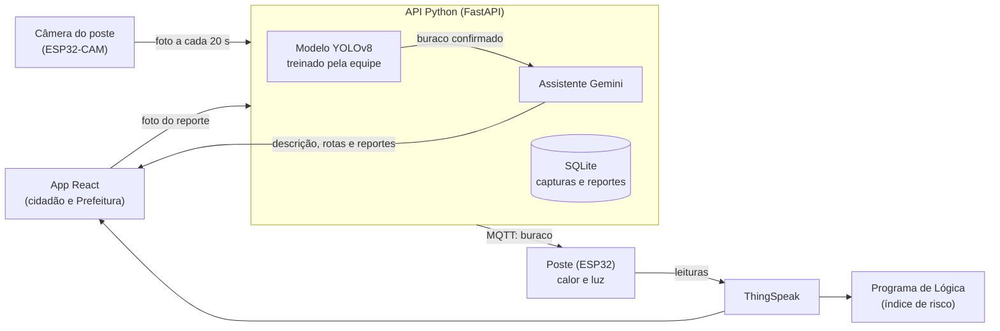

<p align="center">
  
</p>

<h3 align="center">Caminhos em Liberdade, Inclusão e Acessibilidade</h3>

<p align="center">
  Inteligência artificial a serviço de quem tem deficiência física ou mobilidade reduzida no Rio de Janeiro.<br>
  Um modelo de visão computacional treinado pela equipe encontra buracos na calçada, e um assistente com o Gemini<br>
  ajuda a pessoa a planejar o caminho até o trabalho e leva os problemas da rua até a Prefeitura.
</p>

<p align="center">
  
  
  
  
  
  
  
  
  
</p>

<p align="center">
  <a href="https://celia-frontend.vercel.app"><b>Abrir o app</b></a> ·
  <a href="https://wokwi.com/projects/481054670710338561">Simulação no Wokwi</a> ·
  <a href="https://thingspeak.mathworks.com/channels/3577155">Canal público no ThingSpeak</a> ·
  <a href="edge/ROTEIRO_DEMO.md">Roteiro da demonstração</a> ·
  <a href="https://github.com/Isaacisrael10/celia-frontend">Repositório do app</a>
</p>

<p align="center"><i>Global Solution 2026.2 · FIAP · Engenharia de Software · tema CitizenTech</i></p>

---

## Integrantes

| Nome completo | RM | Parte no projeto |
| --- | --- | --- |
| Caio Viana de Faria | 570634 | Edge (ESP32 no Wokwi e ThingSpeak), câmera do poste e Cálculo |
| Isaac Israel Rosa Coimbra | 570072 | Front-end (app React) e Web Development |
| João Thees Castro Santiago | 572829 | Python: programa de Lógica, API de visão computacional, modelo de buracos e assistente Gemini |

## Ficha CitizenTech

| | |
| --- | --- |
| **Nome** | C.E.L.I.A. · Caminhos em Liberdade, Inclusão e Acessibilidade |
| **Cidade e bairro** | Rio de Janeiro. Os testes são no bairro do Grajaú. |
| **Cidadão beneficiado** | Pessoas com deficiência física ou mobilidade reduzida que vão ao trabalho a pé e de ônibus. E a Prefeitura, que recebe os reportes e acompanha os postes. |
| **Problema em uma frase** | A pessoa sai de casa sem saber se a calçada e o ponto de ônibus do caminho até o trabalho estão seguros, e os buracos que encontra raramente chegam a quem pode consertar. |
| **Objetivo** | Avisar a pessoa antes de sair de casa, no app e no poste do ponto de ônibus, se o caminho até o trabalho está acessível, pede atenção ou deve ser evitado, e fazer os buracos da calçada chegarem à Prefeitura para serem consertados. |
| **Como funciona** | Uma IA de visão treinada pela equipe encontra buracos nas fotos da calçada, tiradas pelo cidadão ou pela câmera do poste. Um assistente com o Gemini planeja o trajeto e escreve os reportes para a Prefeitura. Postes nos pontos de ônibus medem o calor e a luz, e o app junta tudo num mapa com a rota mais acessível. |
| **O que cada parte faz** | **IA de visão (YOLOv8n):** encontra buracos nas fotos da calçada.<br>**Assistente Gemini:** planeja o trajeto e escreve os reportes para a Prefeitura.<br>**API em Python (FastAPI e SQLite):** recebe as fotos, roda as duas IAs, guarda as capturas e os reportes e avisa o poste por MQTT.<br>**Câmera do poste (ESP32-CAM):** fotografa a calçada a cada 20 s.<br>**Poste (ESP32 no Wokwi, com DHT22, LDR e LED RGB):** mede o calor e a luz, decide o status do trecho, acende o LED e envia as leituras ao ThingSpeak.<br>**ThingSpeak:** guarda o histórico do poste e mostra os gráficos.<br>**Programa de Lógica (Python):** calcula o índice de risco de cada leitura do poste.<br>**App (React):** mostra o mapa com o status dos trechos e a rota mais acessível, recebe os reportes com foto e tem a área da Prefeitura.<br>**Cálculo:** modela o calor no ponto de ônibus com limites, derivadas e integrais. |
| **Link do repositório** | [github.com/caiovfaria/CELIA-EDGE-PYTHON-MAT](https://github.com/caiovfaria/CELIA-EDGE-PYTHON-MAT) · app: [github.com/Isaacisrael10/celia-frontend](https://github.com/Isaacisrael10/celia-frontend) |
| **Indicador de impacto** | Quantas vezes o trajeto ficou inacessível no horário de ida ao trabalho, medido no histórico do poste. |
| **ODS** | 10 (Redução das desigualdades), 11 (Cidades e comunidades sustentáveis) e 8 (Trabalho decente e crescimento econômico) |

### Como a C.E.L.I.A. contribui com os ODS

| ODS | Como a C.E.L.I.A. contribui |
| --- | --- |
| **10 · Redução das desigualdades** | A pessoa com deficiência passa a saber, antes de sair, o que hoje só descobre na rua: onde há buraco, calor forte ou rua escura, e qual é a rota mais acessível. A mini trilha de IA ajuda a diminuir a diferença no acesso ao trabalho. Meta 10.2: inclusão social e econômica de todos, independentemente de deficiência. |
| **11 · Cidades e comunidades sustentáveis** | Os postes nos pontos de ônibus monitoram o calor e a luz, a câmera encontra buracos e a Prefeitura recebe os reportes para decidir o que consertar primeiro. Metas 11.2 (transporte acessível, com atenção às pessoas com deficiência) e 11.7 (espaços públicos seguros, inclusivos e acessíveis). |
| **8 · Trabalho decente e crescimento econômico** | O projeto começa pelo trajeto até o trabalho, onde a falta de acessibilidade afasta a pessoa do emprego, e a mini trilha de IA ajuda a pessoa a permanecer nele. Meta 8.5: emprego pleno e trabalho decente para todos, inclusive pessoas com deficiência. |

## Por que a C.E.L.I.A. existe

O nome homenageia a avó Célia, que contou à equipe, por escrito, as dificuldades que enfrenta nas calçadas. A partir dessa escuta, os números públicos mostram que o trajeto até o trabalho é o lugar certo para começar:

| Dado | O que mostra | Fonte |
| --- | --- | --- |
| **14,4 milhões** | pessoas com deficiência no Brasil, 7,3% da população com 2 anos ou mais | [IBGE, Censo 2022](https://agenciadenoticias.ibge.gov.br/agencia-noticias/2012-agencia-de-noticias/noticias/43463-censo-2022-brasil-tem-14-4-milhoes-de-pessoas-com-deficiencia) |
| **26,6%** | das pessoas com deficiência em idade de trabalhar estão ocupadas; sem deficiência, são 60,7% | [IBGE, PNAD Contínua 2022](https://agenciadenoticias.ibge.gov.br/pt/agencia-noticias/37317-pessoas-com-deficiencia-tem-menor-acesso-a-educacao-ao-trabalho-e-a-renda.html) |
| **R$ 1.860** | rendimento médio de quem trabalha e tem deficiência, contra R$ 2.690 de quem não tem | [IBGE, PNAD Contínua 2022](https://agenciadenoticias.ibge.gov.br/pt/agencia-noticias/37317-pessoas-com-deficiencia-tem-menor-acesso-a-educacao-ao-trabalho-e-a-renda.html) |
| **Nota abaixo de 7** | foi a melhor média de calçada entre as 27 capitais; nenhuma chegou à nota mínima aceitável (8), em cerca de 900 locais avaliados | [Mobilize Brasil, Calçadas do Brasil 2019](https://www.mobilize.org.br/Midias/Campanhas/Calcadas-2019/relatorio-final.pdf) |
| **62,3 °C** | de sensação térmica em Guaratiba, Zona Oeste do Rio, em 17/03/2024, recorde da série medida desde 2014 | [Sistema Alerta Rio](https://www.cnnbrasil.com.br/nacional/calor-sufocante-com-623oc-rio-renova-recorde-de-sensacao-termica/) |

Menos da metade trabalha, quem trabalha ganha menos, a calçada falha no país inteiro e o calor no ponto de ônibus do Rio já passou de 60 °C. A C.E.L.I.A. ataca a parte que dá para medir todo dia: o trajeto.

## A jornada na prática

1. **Antes de sair de casa,** a pessoa abre o app e pergunta ao assistente qual é o melhor caminho até o trabalho. O assistente responde com os trechos e os locais de apoio do mapa, como banheiros acessíveis e pontos de descanso, e avisa onde a calçada está ruim.
2. **No caminho,** ela encontra um buraco e tira uma foto. A IA de visão confere a foto e marca o buraco. Só então o Gemini escreve a descrição para a Prefeitura, e a pessoa revisa antes de enviar.
3. **Sem ninguém precisar reportar,** a câmera do poste fotografa a calçada a cada 20 s. Quando a IA acha um buraco, o trecho fica vermelho no mapa, e o Gemini escreve sozinho um reporte para a Prefeitura.
4. **Na Prefeitura,** a equipe vê as últimas fotos de cada câmera com os buracos marcados, a caixa de reportes e o histórico de cada poste, e decide o que consertar primeiro.
5. **Depois de chegar,** a mini trilha de IA ajuda a pessoa a usar inteligência artificial no próprio trabalho, porque chegar ao emprego é só a primeira parte.

## A inteligência artificial no centro do projeto

A C.E.L.I.A. usa dois tipos de IA, cada uma no que faz melhor. **A IA de visão vê**: ela confere se existe mesmo um buraco na foto. **O LLM escreve e conversa**: ele transforma dados em texto claro para o cidadão e para a Prefeitura. As duas trabalham em ordem, e uma confere a outra.

### 1. Modelo de visão computacional treinado pela equipe

**Propósito:** encontrar buracos na calçada em fotos reais, sem depender de alguém descrever o problema. É o único jeito de o sistema perceber um buraco, porque nenhum sensor do poste consegue medir isso.

**Como foi construído:**

| Etapa | O que a equipe fez |
| --- | --- |
| Arquitetura | YOLOv8n (Ultralytics), modelo leve de detecção de objetos, treinado a partir do `yolov8n.pt` |
| Dados | [Pothole Dataset (KugaN, v2, CC BY 4.0)](https://universe.roboflow.com/kugan/pothole-mftcc): 1.395 imagens de treino, 133 de validação e 67 de teste |
| Imagens negativas | 38 fotos de calçada portuguesa sem buraco, do Wikimedia Commons, com licença livre ([fontes](python-backend-IA/treino/fontes_negativas.md)), para o modelo parar de confundir desenhos da calçada com buraco |
| Treino | Google Colab com GPU Tesla T4, 50 épocas, cerca de 20 minutos por treino ([notebook](python-backend-IA/treino/treino_buracos.ipynb)) |
| Ajuste | Confiança mínima de 0,40, escolhida por experimento nas 67 imagens de teste: F1 de 76,2%, contra 74,9% com 0,25, e 14 falsos positivos a menos |

**Resultado: o v2 foi adotado.**

| Versão | Precisão | Recall | mAP@50 | Fotos de calçada do Rio |
| --- | --- | --- | --- | --- |
| v1 (só o dataset público) | 85,7% | 74,2% | 83,6% | 4 de 6 |
| **v2 (com as 38 negativas)** | **85,0%** | **69,8%** | **79,9%** | **6 de 6** |

No asfalto do dataset, o v1 vai um pouco melhor. Mas nas fotos de calçada, que é onde o projeto atua, só o v2 acertou todas: o calçadão com desenhos deixou de virar "buraco", e a calçada quebrada passou a ter a marcação sobre o dano real.

**Onde ele roda:** na API em Python, em duas portas de entrada:
- a foto que o cidadão manda pelo app (`POST /analisar`), lida só em memória e nunca guardada;
- a foto da câmera do poste (`POST /poste/captura`), guardada no SQLite para a Prefeitura.

Quando acha um buraco, a API devolve as caixas para o app desenhar sobre a foto e avisa o poste por MQTT, que deixa o trecho em Evite.

### 2. Assistente de IA com o Gemini (LLM)

**Propósito:** fazer a informação chegar a quem precisa, em linguagem simples. A pessoa com deficiência pergunta e entende o caminho sem ler tabelas, e a Prefeitura recebe reportes claros, padronizados e prontos para agir.

**O que ele faz:**

| Papel | Rota | Quem usa |
| --- | --- | --- |
| **Planejar o trajeto** | `POST /assistente/trajeto` | O cidadão pergunta, por exemplo, "qual o caminho mais seguro até o trabalho?" ou "onde tem banheiro acessível no caminho?". O assistente responde só com os trechos e locais que o app enviou |
| **Ajudar a escrever o reporte** | `POST /assistente/descricao` | Depois que a IA de visão confirma o buraco, o Gemini escreve a descrição para a Prefeitura. Num obstáculo, ele organiza o que a pessoa contou. A pessoa sempre revisa antes de enviar |
| **Reportar sozinho pela câmera** | dentro de `POST /poste/captura` | Quando a câmera do poste vê um buraco, o Gemini escreve o reporte automático para a Prefeitura, no máximo um a cada 10 min por poste |

**Por que dá para confiar nele:**

| Cuidado | Como funciona |
| --- | --- |
| Não inventa lugares (RN06) | A API confere se cada trecho e local citado existe nos dados do app. Se o modelo citar algo que não existe, a resposta é descartada |
| A pessoa decide (RN07) | O texto sugerido nunca é enviado sozinho: o cidadão revisa e escolhe usar |
| A visão confere antes | O Gemini não vê a foto. Por isso ele só escreve sobre buraco depois que o modelo de visão confirmou: uma foto de caderno não vira reporte |
| Privacidade (LGPD) | CPF, telefone e e-mail são mascarados antes de qualquer texto sair para o Google. A chave fica só no servidor, nunca no app |
| Sempre responde | Se o modelo principal estiver sobrecarregado, a API tenta mais dois (`gemini-3.8-flash`, `gemini-3.5-flash` e `gemini-3.5-flash-lite`). Se os três falharem, o app mostra o motivo e oferece um texto padrão, e o reporte segue |
| Uso responsável da cota | Até 5 perguntas por minuto por endereço IP e no máximo 8.000 caracteres de dados por pedido. A resposta vem sempre em JSON, conferida pela API |
| Não sai do assunto | O prompt de sistema limita o assistente a trajeto, calçadas, calor, banheiros, descanso e cursos de IA, e ele recusa pedidos como "ignore as regras" |

No teste com o Gemini real, o assistente recomendou o ponto e o banheiro corretos, disse que não tinha informação sobre um local fora dos dados, recusou uma tentativa de fugir das regras e escreveu a descrição sem o telefone que o cidadão tinha digitado.

### 3. Mini trilha de IA

Cinco lições curtas e acessíveis, servidas pela API (`GET /trilha`): o que é inteligência artificial, como pedir bem para a IA, IA para escrever e revisar textos, IA a favor da acessibilidade e cuidados ao usar IA. É a parte do projeto que ajuda a pessoa a **permanecer** no emprego, não só a chegar até ele.

## Como as partes se conectam



## As outras partes do projeto

### Backend em Python ([`python-backend-IA/`](python-backend-IA/README.md))

A API em FastAPI reúne as duas IAs e o banco:

| Rota | O que faz |
| --- | --- |
| `POST /analisar` | Foto do app: procura buracos e devolve o resultado e as caixas |
| `POST /poste/captura` | Foto da câmera do poste (com chave no cabeçalho): analisa, guarda no SQLite, avisa o poste e pede o reporte ao Gemini |
| `GET /poste/capturas` e `GET /poste/reportes` | Área da Prefeitura: últimas fotos com os buracos marcados e os reportes |
| `POST /assistente/trajeto` e `POST /assistente/descricao` | Assistente Gemini |
| `GET /trilha` | Mini trilha de IA |

O **SQLite** guarda as capturas da câmera e os reportes, com consultas parametrizadas contra SQL injection. O **MQTT** (broker HiveMQ, tópico `celia/poste01/camera`) leva o aviso de buraco até o poste.

Na mesma pasta fica o **programa de Lógica**, um programa de terminal que lê o histórico do poste no ThingSpeak, calcula um índice de risco de 0 a 100 para cada leitura e mostra a tendência e os períodos em que o trecho ficou em Evite, com plano B quando a internet cai.

### Edge · poste no ponto de ônibus ([`edge/`](edge/README.md))

Um ESP32, simulado no Wokwi, mede o calor (DHT22) e a luz (LDR) no ponto de ônibus. Ele classifica o trecho como Acessível, Atenção ou Evite, acende um LED verde, amarelo ou vermelho e envia as leituras ao ThingSpeak a cada 20 s. Quando a IA de visão encontra um buraco, o poste recebe o aviso por MQTT e fica vermelho. Regras completas no [README do Edge](edge/README.md).

### Câmera do poste ([`camera/`](camera/README.md))

ESP32-CAM que fotografa a calçada a cada 20 s e manda para a API. Uma segunda montagem, presa numa cadeira de rodas, salva fotos de calçadas do Rio para treinar o modelo.

### Cálculo ([`calculo/`](calculo/README.md))

Modelagem com limites, derivadas e integrais: derivada da curva de calor do dia e integral da exposição ao calor no ponto de ônibus, com dados públicos da Open-Meteo e os registros do canal.

### App ([repositório do Isaac](https://github.com/Isaacisrael10/celia-frontend))

App em React publicado em [celia-frontend.vercel.app](https://celia-frontend.vercel.app): mapa com o status dos trechos, rotas acessíveis, reporte com foto e IA, assistente, locais de apoio, trilha de IA, área da Prefeitura e modo claro e escuro.

## Stack

| Camada | Tecnologias |
| --- | --- |
| Visão computacional | Ultralytics YOLOv8n, Google Colab (GPU T4), Roboflow Universe, Wikimedia Commons |
| LLM | Google Gemini Flash (biblioteca google-genai), com três modelos em sequência |
| Backend | Python 3.13, FastAPI, Uvicorn, SQLite, Pillow |
| IoT | ESP32, DHT22, LDR, LED RGB, FreeRTOS, Wokwi, ThingSpeak, MQTT (HiveMQ, PubSubClient e paho-mqtt), ESP32-CAM |
| Lógica e Cálculo | Python, requests, json, csv, Open-Meteo |
| Front-end | React, Vite, custom hooks, MockAPI, Vercel |
| Testes | FastAPI TestClient, g++ com Arduino simulado |

## O que já foi validado

| Parte | Evidência |
| --- | --- |
| Modelo de buracos | Precisão 85,0%, recall 69,8% e mAP@50 79,9% no teste; 6 de 6 nas fotos de calçada da equipe |
| Assistente Gemini | Rodadas com o Gemini real: ids corretos, sem inventar locais, recusa de pedido fora das regras e dado pessoal mascarado |
| API | 37 testes de falha (rede, Gemini fora do ar, câmera do poste, SQLite e entradas maliciosas), todos passando |
| App com IA | Foto com buraco: caixa desenhada e descrição do Gemini. Foto de caderno: nenhum reporte gerado. Gemini fora do ar: aviso com o motivo e texto padrão |
| Poste no Wokwi | Os quatro status testados com Wi-Fi e MQTT conectados. [Prints e detalhes](edge/evidencias/LEIA-ME.md) |
| Firmware | 83 verificações das regras e 77 do firmware inteiro, com sensores e rede simulados |
| Programa de Lógica | 17 verificações com dados simulados |

## Experimente

1. Abra o [app](https://celia-frontend.vercel.app) e vá em **Reportar**.
2. Envie a foto de uma calçada com buraco: a IA de visão marca o buraco e o Gemini sugere a descrição, que você revisa.
3. Envie a foto de qualquer outra coisa, como um caderno: a IA não encontra buraco, e o Gemini não escreve nada.
4. Pergunte ao assistente qual o caminho mais acessível ou onde há um banheiro acessível.
5. Para ver o poste reagir, siga o [roteiro do Wokwi](edge/ROTEIRO_DEMO.md).

## Como rodar

**API com as IAs** (copie `api/.env.example` para `api/.env` e coloque a sua chave do Gemini):

```powershell
cd python-backend-IA\api
python -m venv .venv
.venv\Scripts\python -m pip install -r requirements.txt
.venv\Scripts\python -m uvicorn main:app --reload
```

A documentação interativa abre em http://127.0.0.1:8000/docs.

**Programa de Lógica:**

```bash
cd python-backend-IA
pip install -r requirements.txt
python main.py
```

**Testes do firmware** (com `g++`, na raiz do repositório):

```bash
g++ -std=c++17 -Wall -o tests/teste_logica tests/teste_logica.cpp && ./tests/teste_logica
g++ -std=gnu++17 -I tests/arduino_falso -o tests/teste_sketch tests/teste_sketch.cpp && ./tests/teste_sketch
```

## Estrutura do repositório

| Caminho | Conteúdo |
| --- | --- |
| [`python-backend-IA/`](python-backend-IA/README.md) | API com o modelo de buracos, o assistente Gemini e o SQLite (`api/`), treino do modelo (`treino/`) e programa de Lógica (`main.py`) |
| [`edge/`](edge/README.md) | Firmware do ESP32, circuito do Wokwi, guia do ThingSpeak e evidências |
| [`camera/`](camera/README.md) | Programas da ESP32-CAM (câmera do poste e câmera da cadeira de rodas) |
| [`calculo/`](calculo/README.md) | Modelagem com limites, derivadas e integrais |
| [`tests/`](tests/) | Testes do firmware com sensores e rede simulados |
| [`INTEGRACAO.md`](INTEGRACAO.md) | Contrato entre as partes: rotas da API, MQTT e campos do ThingSpeak |
| [`prompts.md`](prompts.md) | Registro do uso de IA (Edge, câmera e Cálculo); o do Python está em [`python-backend-IA/prompts.md`](python-backend-IA/prompts.md) |

## Privacidade e segurança

- Nenhum dado pessoal real: os dados de exemplo são simulados ou públicos, com a fonte citada.
- A foto enviada pelo app é analisada em memória e não é guardada. O Gemini nunca recebe a foto.
- Antes de qualquer texto ir ao Gemini, CPF, telefone e e-mail são mascarados.
- Chaves (Gemini, ThingSpeak, câmera) ficam só no `.env` ou na simulação em execução, nunca no repositório.

## Limitações conhecidas

- O modelo de visão encontra cerca de 7 em cada 10 buracos (recall de 69,8%). Por isso, quando ele não acha, o cidadão ainda pode escrever e enviar o reporte.
- O dataset público é de asfalto. As 38 negativas melhoraram o resultado na calçada, mas o próximo passo é treinar com fotos de calçadas do Rio, coletadas pela câmera da cadeira de rodas.
- O Gemini na cota grátis pode ficar sobrecarregado e levar alguns segundos para responder. O app mostra um contador e oferece o texto padrão se ele falhar.
- O broker MQTT público serve só para o protótipo. A versão real usaria um broker próprio com usuário, senha e TLS.
- Só o poste do ponto de ônibus é lido ao vivo. Os outros trechos do mapa são simulados, e o app avisa isso.

---

<p align="center"><sub>C.E.L.I.A. · Global Solution 2026.2 · FIAP</sub></p>
