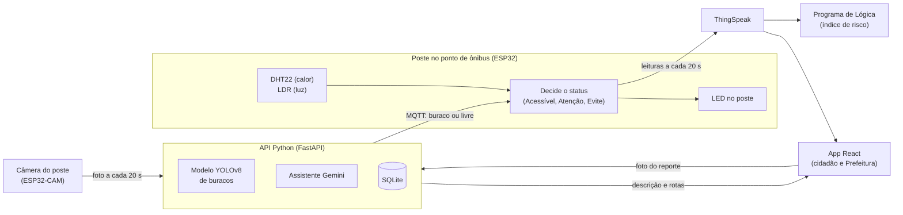

<p align="center">
  
</p>

<h3 align="center">Caminhos em Liberdade, Inclusão e Acessibilidade</h3>

<p align="center">
  Luz, calor e buracos na calçada perto dos pontos de ônibus do Rio de Janeiro, em uma leitura rápida,<br>
  para a pessoa com deficiência física ou mobilidade reduzida escolher o melhor caminho até o trabalho.
</p>

<p align="center">
  
  
  
  
  
  
  
  
  
</p>

<p align="center">
  <a href="https://celia-frontend.vercel.app"><b>Abrir o app</b></a> ·
  <a href="https://wokwi.com/projects/481054670710338561">Simulação no Wokwi</a> ·
  <a href="https://thingspeak.mathworks.com/channels/3577155">Canal público no ThingSpeak</a> ·
  <a href="edge/ROTEIRO_DEMO.md">Roteiro da demonstração</a> ·
  <a href="https://github.com/Isaacisrael10/celia-frontend">Repositório do app</a>
</p>

<p align="center"><i>Global Solution 2026.2 · FIAP · Engenharia de Software · tema CitizenTech</i></p>

---

## Integrantes

| Nome completo | RM | Parte no projeto |
| --- | --- | --- |
| Caio Viana de Faria | 570634 | Edge (ESP32 no Wokwi e ThingSpeak), câmera do poste e Cálculo |
| Isaac Israel Rosa Coimbra | 570072 | Front-end (app React) e Web Development |
| João Thees Castro Santiago | 572829 | Python: programa de Lógica, API de visão computacional, modelo de buracos e assistente Gemini |

## Ficha CitizenTech

| | |
| --- | --- |
| **Nome** | C.E.L.I.A. · Caminhos em Liberdade, Inclusão e Acessibilidade |
| **Cidade e bairro** | Rio de Janeiro. Os testes são no bairro do Grajaú. |
| **Cidadão beneficiado** | Pessoas com deficiência física ou mobilidade reduzida que vão ao trabalho a pé e de ônibus. E a Prefeitura, que recebe os reportes e acompanha os postes. |
| **Problema em uma frase** | A pessoa sai de casa sem saber se a calçada e o ponto de ônibus do caminho até o trabalho estão seguros: escuros, quentes demais ou com buracos. |
| **Como funciona** | Postes nos pontos de ônibus medem luz e calor; uma câmera com IA procura buracos; o app mostra a situação de cada trecho, sugere a rota mais acessível e leva os problemas até a Prefeitura. |
| **Indicador de impacto** | Quantas vezes o trajeto ficou inacessível no horário de ida ao trabalho, medido no histórico do poste. |
| **ODS** | 10 (Redução das desigualdades), 11 (Cidades e comunidades sustentáveis) e 8 (Trabalho decente e crescimento econômico) |

## Por que a C.E.L.I.A. existe

O nome homenageia a avó Célia, que contou à equipe, por escrito, as dificuldades que enfrenta nas calçadas. A partir dessa escuta, os números públicos mostram que o trajeto até o trabalho é o lugar certo para começar:

| Dado | O que mostra | Fonte |
| --- | --- | --- |
| **14,4 milhões** | pessoas com deficiência no Brasil, 7,3% da população com 2 anos ou mais | [IBGE, Censo 2022](https://agenciadenoticias.ibge.gov.br/agencia-noticias/2012-agencia-de-noticias/noticias/43463-censo-2022-brasil-tem-14-4-milhoes-de-pessoas-com-deficiencia) |
| **26,6%** | das pessoas com deficiência em idade de trabalhar estão ocupadas; sem deficiência, são 60,7% | [IBGE, PNAD Contínua 2022](https://agenciadenoticias.ibge.gov.br/pt/agencia-noticias/37317-pessoas-com-deficiencia-tem-menor-acesso-a-educacao-ao-trabalho-e-a-renda.html) |
| **R$ 1.860** | rendimento médio de quem trabalha e tem deficiência, contra R$ 2.690 de quem não tem | [IBGE, PNAD Contínua 2022](https://agenciadenoticias.ibge.gov.br/pt/agencia-noticias/37317-pessoas-com-deficiencia-tem-menor-acesso-a-educacao-ao-trabalho-e-a-renda.html) |
| **Nota abaixo de 7** | foi a melhor média de calçada entre as 27 capitais; nenhuma chegou à nota mínima aceitável (8), em cerca de 900 locais avaliados | [Mobilize Brasil, Calçadas do Brasil 2019](https://www.mobilize.org.br/Midias/Campanhas/Calcadas-2019/relatorio-final.pdf) |
| **62,3 °C** | de sensação térmica em Guaratiba, Zona Oeste do Rio, em 17/03/2024, recorde da série medida desde 2014 | [Sistema Alerta Rio](https://www.cnnbrasil.com.br/nacional/calor-sufocante-com-623oc-rio-renova-recorde-de-sensacao-termica/) |

Menos da metade trabalha, quem trabalha ganha menos, a calçada falha no país inteiro e o calor no ponto de ônibus do Rio já passou de 60 °C. A C.E.L.I.A. ataca a parte que dá para medir todo dia: o trajeto.

## Impacto esperado

- **Para a pessoa com deficiência:** sai de casa sabendo quais trechos estão escuros, quentes demais ou com buraco, e escolhe outro caminho antes de encontrar a barreira.
- **Para a Prefeitura:** recebe reportes com foto, classificação da IA e descrição, e vê no histórico dos postes onde a calçada falha com mais frequência para decidir o que consertar, iluminar ou cobrir primeiro.
- **Para a permanência no emprego:** a mini trilha de IA do app ensina, em lições curtas e acessíveis, a usar inteligência artificial no trabalho.

## Como funciona



1. **O poste mede.** O ESP32 lê o calor (DHT22) e a luz (LDR) a cada 5 s, decide o status do trecho, acende o LED e envia as leituras ao ThingSpeak.
2. **A câmera procura buracos.** A ESP32-CAM manda uma foto da calçada para a API, que roda o modelo de buracos treinado pela equipe. Se achar um buraco, a API avisa o poste por MQTT, o trecho fica em Evite e um reporte é escrito pelo Gemini para a Prefeitura.
3. **O app mostra e ajuda.** O app lê o ThingSpeak, pinta o mapa, sugere a rota mais acessível e deixa o cidadão reportar problemas com foto. O assistente Gemini ajuda a planejar o trajeto e a escrever a descrição, que a pessoa revisa antes de enviar.
4. **O Python analisa o histórico.** O programa de Lógica lê as leituras do canal, calcula um índice de risco, a tendência e os episódios em Evite.

## As partes do projeto

### Edge · ESP32 no Wokwi ([`edge/`](edge/README.md))

ESP32 com DHT22, LDR e LED RGB, programado com tarefas do FreeRTOS: uma lê e decide, outra envia ao ThingSpeak e outra ouve a câmera por MQTT. Nenhuma espera de rede trava o poste.

| LED | Status | Quando aparece |
| --- | --- | --- |
| 🟢 Verde | **0 · Acessível** | Luz normal (ou sol) e calor normal |
| 🟡 Amarelo | **1 · Atenção** | Rua escura, ou calor elevado sem sol direto |
| 🔴 Vermelho | **2 · Evite** | Sol direto com calor elevado, ou buraco visto pela câmera |

A rua conta como escura abaixo de 10 lux e como sol direto a partir de 25.000 lux. O índice de calor entra em atenção a partir de 32 °C e em perigo a partir de 41 °C. Uma mudança de luz só vale depois de 15 s (demonstração) ou 60 s (modo normal): a sombra de um ônibus ou o farol de um carro não mudam o trecho.

### Python · programa de Lógica ([`python-backend-IA/`](python-backend-IA/README.md))

Programa de terminal com menu que lê as leituras do canal público do ThingSpeak (índice de calor no field3 e luz no field7) e calcula o índice de risco de cada leitura: `risco = 0,5 × nível do calor + 0,5 × nível da luz`. Mostra as faixas com as mesmas cores do app, a tendência (PIORANDO depois de 3 altas seguidas) e o maior episódio em Evite. Usa um plano B com `backup.json` quando o ThingSpeak não responde, guarda o `historico.json` sem repetir leituras e gera o `relatorio.csv`.

### Backend · API em Python ([`python-backend-IA/api/`](python-backend-IA/api/main.py))

| Rota | O que faz |
| --- | --- |
| `POST /analisar` | Recebe a foto do app, procura buracos e devolve o resultado e as caixas para desenhar na foto. A foto é lida só em memória |
| `POST /poste/captura` | Recebe o JPEG da câmera do poste (chave no cabeçalho), analisa, guarda no SQLite e avisa o poste por MQTT |
| `GET /poste/capturas` e `GET /poste/reportes` | Área da Prefeitura: últimas fotos com os buracos marcados e os reportes gerados |
| `POST /assistente/trajeto` | Assistente de IA que planeja o trajeto só com os dados do app |
| `POST /assistente/descricao` | Sugere a descrição do reporte, que o cidadão revisa antes de enviar |
| `GET /trilha` | Lições da mini trilha de IA |

- **Modelo de buracos (YOLOv8):** treinado pela equipe no Google Colab com o [Pothole Dataset (KugaN, CC BY 4.0)](https://universe.roboflow.com/kugan/pothole-mftcc) e 38 fotos de calçada sem buraco. No teste: **precisão 85,0%, recall 69,8% e mAP@50 79,9%**. Nas fotos de calçada da equipe, acertou 6 de 6. Notebook em [`python-backend-IA/treino/`](python-backend-IA/treino/treino_buracos.ipynb).
- **LLM (Gemini Flash):** chamado só pela API, nunca pelo app. Se um modelo falhar, a API tenta outros dois (`gemini-3.8-flash`, `gemini-3.5-flash` e `gemini-3.5-flash-lite`). O assistente responde só com os locais que o app enviou e não inventa lugares (RN06). CPF, telefone e e-mail são mascarados antes do envio.
- **SQLite:** guarda as capturas da câmera do poste e os reportes, com consultas parametrizadas contra SQL injection.
- **MQTT:** a API publica `buraco` ou `livre` no tópico `celia/poste01/camera` (HiveMQ), e o ESP32 assina.

### Cálculo ([`calculo/`](calculo/README.md))

Modelagem do fenômeno urbano com limites, derivadas e integrais: limite na regra da calçada, derivada da curva de calor do dia e integral da exposição ao calor no ponto de ônibus, com dados públicos da Open-Meteo e os registros do canal.

### Câmera do poste ([`camera/`](camera/README.md))

Exemplo explicado da ESP32-CAM que fotografa a calçada a cada 20 s e envia para a API, e de uma segunda montagem, presa numa cadeira de rodas, que salva fotos de calçadas para treinar o modelo.

### App ([repositório do Isaac](https://github.com/Isaacisrael10/celia-frontend))

App em React publicado em [celia-frontend.vercel.app](https://celia-frontend.vercel.app): mapa com o status dos trechos, rotas acessíveis, reportes com foto e IA, locais de apoio, trilha de IA, área da Prefeitura e modo claro e escuro.

## Stack

| Camada | Tecnologias |
| --- | --- |
| Dispositivo | ESP32 DevKit, DHT22, LDR, LED RGB, FreeRTOS, simulação no Wokwi |
| IoT | ThingSpeak (HTTP), MQTT com broker HiveMQ (PubSubClient e paho-mqtt) |
| Câmera | ESP32-CAM |
| Backend | Python 3.13, FastAPI, Uvicorn, SQLite |
| Visão computacional | Ultralytics YOLOv8n, Google Colab, dataset do Roboflow Universe |
| LLM | Google Gemini Flash (biblioteca google-genai) |
| Lógica e Cálculo | Python, requests, json, csv, Open-Meteo |
| Front-end | React, Vite, custom hooks, MockAPI, Vercel |
| Testes | g++ com Arduino simulado, FastAPI TestClient |

## O que já foi validado

| Parte | Evidência |
| --- | --- |
| Poste no Wokwi (18/11) | Com Wi-Fi e MQTT conectados, passou por luz normal (verde), rua escura (amarelo), calor (amarelo) e sol direto com calor (vermelho). [Prints e detalhes](edge/evidencias/LEIA-ME.md) |
| Firmware | 83 verificações das regras e 77 do firmware inteiro, com sensores, Wi-Fi, ThingSpeak e MQTT simulados. Todas passando |
| API e assistente | 37 testes de falha (rede, Gemini fora do ar, câmera do poste, SQLite e entradas maliciosas), todos passando, e rodadas com o Gemini real |
| Modelo de buracos | Precisão 85,0%, recall 69,8% e mAP@50 79,9% no conjunto de teste; 6 de 6 nas fotos de calçada da equipe |
| Programa de Lógica | 17 verificações com dados simulados de luz e calor; os 4 cenários do roteiro do poste dão a mesma faixa do LED |

## Experimente

1. Abra o [projeto no Wokwi](https://wokwi.com/projects/481054670710338561) e inicie a simulação.
2. Comece com o módulo de luz em **500 lux** e o DHT22 a **26 °C** e **50%** de umidade: o LED fica verde.
3. Mude a luz para **5 lux**. Depois de 15 s, o LED fica amarelo e o serial mostra `motivo 1 luz`.
4. Com **33 °C** e **50.000 lux**, o LED fica vermelho: sol direto com calor. O passo a passo completo está no [roteiro](edge/ROTEIRO_DEMO.md).
5. Abra o [app](https://celia-frontend.vercel.app) para ver o poste no mapa e reportar um problema com foto.

## Como rodar

**Testes do firmware** (com `g++`, na raiz do repositório):

```bash
g++ -std=c++17 -Wall -o tests/teste_logica tests/teste_logica.cpp && ./tests/teste_logica
g++ -std=gnu++17 -I tests/arduino_falso -o tests/teste_sketch tests/teste_sketch.cpp && ./tests/teste_sketch
```

**Programa de Lógica:**

```bash
cd python-backend-IA
pip install -r requirements.txt
python main.py
```

**API** (copie `api/.env.example` para `api/.env` e coloque a sua chave do Gemini):

```powershell
cd python-backend-IA\api
python -m venv .venv
.venv\Scripts\python -m pip install -r requirements.txt
.venv\Scripts\python -m uvicorn main:app --reload
```

A documentação interativa abre em http://127.0.0.1:8000/docs.

## Estrutura do repositório

| Caminho | Conteúdo |
| --- | --- |
| [`edge/`](edge/README.md) | Firmware do ESP32 (`sketch.ino`), regras (`celia_logica.h`), circuito do Wokwi, guia do ThingSpeak e evidências |
| [`python-backend-IA/`](python-backend-IA/README.md) | Todo o Python do projeto: programa de Lógica, API, assistente Gemini, SQLite, modelo de buracos e treino |
| [`calculo/`](calculo/README.md) | Modelagem com limites, derivadas e integrais |
| [`camera/`](camera/README.md) | Programas da ESP32-CAM (câmera do poste e câmera da cadeira de rodas) |
| [`tests/`](tests/) | Testes da lógica e do firmware com sensores e rede simulados |
| [`INTEGRACAO.md`](INTEGRACAO.md) | Contrato entre as partes: campos do ThingSpeak, MQTT e rotas da API |
| [`prompts.md`](prompts.md) | Registro do uso de IA (Edge, câmera e Cálculo); o do Python está em [`python-backend-IA/prompts.md`](python-backend-IA/prompts.md) |

## Privacidade e segurança

- Nenhum dado pessoal real: os dados de exemplo são simulados ou públicos, com a fonte citada.
- A foto enviada pelo app é analisada em memória e não é guardada. Só o resultado trafega (RNF01).
- Antes de qualquer texto ir ao Gemini, CPF, telefone e e-mail são mascarados.
- Chaves (Gemini, ThingSpeak, câmera) ficam só no `.env` ou na simulação em execução, nunca no repositório.

## Limitações conhecidas

- O broker MQTT público serve só para o protótipo: qualquer pessoa pode ler e publicar no tópico. A versão real usaria um broker próprio com usuário, senha e TLS.
- O modelo foi treinado com fotos de asfalto e pode errar em calçadas do Rio, como a pedra portuguesa. Ele encontra cerca de 7 em cada 10 buracos (recall de 69,8%).
- O envio ao ThingSpeak usa HTTP simples na simulação. Um poste de verdade deve usar HTTPS com certificado.
- Só o poste do ponto de ônibus é lido ao vivo. Os outros trechos do mapa são simulados, e o app avisa isso.

---

<p align="center"><sub>C.E.L.I.A. · Global Solution 2026.2 · FIAP</sub></p>
