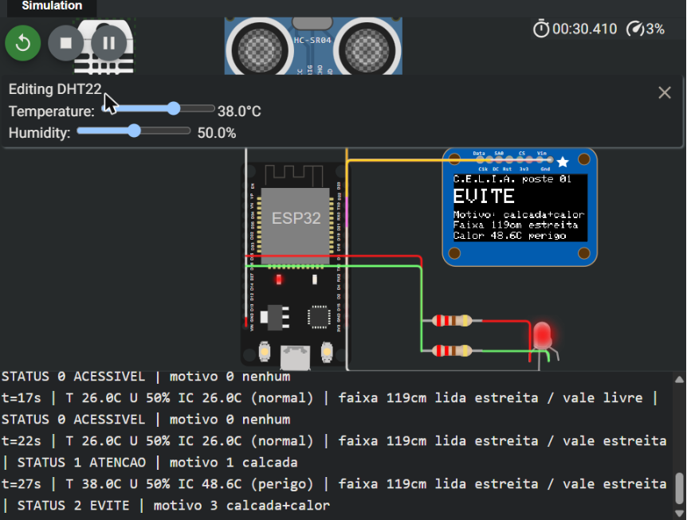

# C.E.L.I.A.

**Condições da calçada e calor perto de pontos de ônibus, em uma leitura rápida.**

Protótipo de acessibilidade urbana desenvolvido para a **Global Solution 2026.2 da FIAP**, no tema CitizenTech. A proposta é instalar módulos em postes perto de pontos de ônibus no Rio de Janeiro para ajudar pessoas com deficiência física ou mobilidade reduzida a escolher por onde passar.

[Abrir a simulação no Wokwi](https://wokwi.com/projects/480457503878659073) · [Ver o canal público no ThingSpeak](https://thingspeak.mathworks.com/channels/3577155) · [Seguir o roteiro da demonstração](edge/ROTEIRO_DEMO.md)



*Demonstração da Etapa 1. Com 119 cm de passagem e temperatura de 38 °C, o OLED mostra EVITE e o LED fica vermelho.*

## Como o poste decide

1. **Mede a cada 5 s.** O HC-SR04 estima a largura livre de passagem. O DHT22 mede temperatura e umidade para calcular o índice de calor.
2. **Confirma uma mudança na calçada.** A nova faixa precisa persistir por 15 s na demonstração ou 60 s no modo normal. Uma pessoa passando pelo sensor por alguns segundos não dispara um alerta de bloqueio.
3. **Mostra e publica o status.** O ESP32 atualiza o OLED e o LED no local. Uma tarefa de rede envia a última leitura disponível ao ThingSpeak e espera 20 s após o fim de cada tentativa. O poste continua avaliando o trecho durante a espera pela rede.

| LED | Status | Quando aparece |
| --- | --- | --- |
| 🟢 Verde | **0 · Acessível** | Calçada livre e calor normal |
| 🟡 Amarelo | **1 · Atenção** | Calçada estreita sem calor em perigo, ou calçada livre com calor elevado |
| 🔴 Vermelho | **2 · Evite** | Calçada bloqueada, ou calçada estreita com calor em perigo |

A regra usa **120 cm** para a faixa livre e **90 cm** como mínimo para a faixa estreita. Para o índice de calor, a atenção começa em **32 °C** e o protótipo usa **41 °C** para perigo.

## Experimente

1. Abra o [projeto no Wokwi](https://wokwi.com/projects/480457503878659073) e inicie a simulação. Para rodar exatamente a versão deste repositório, use os arquivos de [`edge/`](edge/).
2. No HC-SR04, comece em **200 cm**. Com o DHT22 a **26 °C** e **50%** de umidade, o LED fica verde.
3. Mude a distância para **50 cm**. Quando a mudança for confirmada, o OLED mostra **EVITE** e o LED fica vermelho.
4. Para acompanhar os envios, veja o [guia do ThingSpeak](edge/THINGSPEAK.md). A demonstração local funciona sem uma chave de escrita.

## O que já foi validado

- **Circuito e regras locais.** A simulação com leitura de 5 s e confirmação de 15 s registrou estreitamento, alerta por calor, bloqueio e liberação. [Evidências da Etapa 1](edge/evidencias/LEIA-ME.md)
- **Telemetria.** A primeira versão registrou 11 envios reais no canal público. Uma revisão intermediária confirmou no Wokwi que o poste continuava lendo enquanto a tarefa de rede fazia pedidos HTTP. Na versão atual, a equipe reportou **97 verificações da lógica e 56 do sketch**, todas passando. Falta validar no Wokwi um envio aceito com **50 cm confirmados, LED vermelho e `field5=2`**, e registrar a folga de pilha da tarefa de rede. [Evidências da Etapa 2](edge/evidencias/etapa2/LEIA-ME.md)
- **Próximas etapas.** Detecção de buracos em fotos com YOLO, integração via MQTT e consumo dos alertas pelo app.

## Código e testes

| Caminho | Conteúdo |
| --- | --- |
| [`edge/sketch.ino`](edge/sketch.ino) | Firmware do ESP32 e envio ao ThingSpeak |
| [`edge/celia_logica.h`](edge/celia_logica.h) | Regras de classificação e confirmação |
| [`edge/diagram.json`](edge/diagram.json) | Circuito no Wokwi |
| [`tests/`](tests/) | Testes da lógica e do firmware com sensores e rede simulados |

Com `g++` disponível, rode na raiz do repositório:

```sh
g++ -std=c++17 -Wall -o tests/teste_logica tests/teste_logica.cpp && ./tests/teste_logica
g++ -std=gnu++17 -I tests/arduino_falso -o tests/teste_sketch tests/teste_sketch.cpp && ./tests/teste_sketch
```
