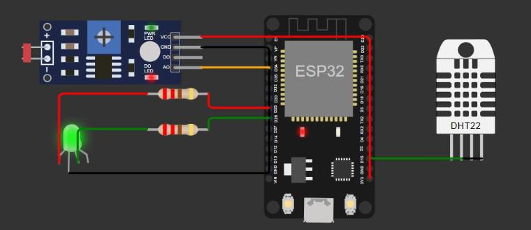

# Edge · poste 01 (DHT22 + LDR + LED)

O poste da C.E.L.I.A. no Wokwi. Ele mede o **calor** (DHT22) e a **luz** (LDR), decide sozinho o status do trecho, mostra no **LED** e manda tudo ao ThingSpeak. A câmera do poste avisa os buracos por MQTT. O poste avisa quando a rua está **escura** (não dá para ver buraco, degrau ou desnível) e quando há **sol direto com calor** (calçada sem sombra num dia quente).

- **Projeto no Wokwi:** https://wokwi.com/projects/481054670710338561
- **Canal no ThingSpeak:** https://thingspeak.mathworks.com/channels/3577155 (`GS-EDGE-C.E.L.I.A.`)
- **Roteiro da demonstração:** [`ROTEIRO_DEMO.md`](ROTEIRO_DEMO.md) · **Guia do ThingSpeak:** [`THINGSPEAK.md`](THINGSPEAK.md)



## Circuito

| Peça | Pino da peça | Pino do ESP32 |
|---|---|---|
| DHT22 (temperatura e umidade) | VCC · GND · SDA | 3V3 · GND · **D15** |
| Módulo de luz (LDR) | VCC · GND · **AO** | 3V3 · GND · **D34** |
| LED RGB (catodo comum) | R · G · COM | D25 (resistor 220 Ω) · D26 (resistor 220 Ω) · GND |

O LDR fica no **D34** porque é uma entrada do ADC1. O ADC2 do ESP32 não funciona com o Wi-Fi ligado. O pino DO do módulo não é usado.

**Cor do LED:** verde = acessível · amarelo (vermelho + verde) = atenção · vermelho = evite · apagado = ainda sem dados.

## Como o poste decide

A cada 5 s o poste lê o DHT22 e o LDR. O LDR é lido 8 vezes seguidas, e o poste usa a média. A leitura do ADC (0 a 4095) vira lux pela fórmula da documentação do Wokwi, com o módulo em 3,3 V.

| Luz \ Calor (índice de calor) | normal (< 32 °C) | atenção (32 a 40,9 °C) | perigo (≥ 41 °C) |
|---|---|---|---|
| **escuro** (< 10 lux) | ATENÇÃO · motivo 1 | ATENÇÃO · motivo 3 | ATENÇÃO · motivo 3 |
| **normal** | ACESSÍVEL · motivo 0 | ATENÇÃO · motivo 2 | ATENÇÃO · motivo 2 |
| **sol direto** (≥ 25.000 lux) | ACESSÍVEL · motivo 0 | **EVITE** · motivo 3 | **EVITE** · motivo 3 |

- **Buraco da câmera:** um `buraco` no tópico MQTT `celia/poste01/camera` deixa o trecho em **EVITE, motivo 5**, por 1 min na demonstração (10 min no valor real), qualquer que seja a luz e o calor. Um `livre` não muda nada.
- **Confirmação da luz:** uma mudança na luz só vale depois de 15 s seguidos na demonstração (1 min no valor real). A sombra de um ônibus ou o farol de um carro passando não mudam o trecho. O calor não precisa de confirmação.
- **Partida:** enquanto o DHT22 não der a primeira leitura, o LED fica apagado e nada vai para o ThingSpeak (a não ser que a câmera avise um buraco).
- Os limites ficam no começo do [`celia_logica.h`](celia_logica.h). Para mudar, troque só as constantes.

## Campos no ThingSpeak

| Campo | O que é | Exemplo |
|---|---|---|
| field1 | Temperatura (°C) | 26.0 |
| field2 | Umidade (%) | 50.0 |
| field3 | Índice de calor (°C) | 26.0 |
| field4 | *não é usado pelo poste* (fica vazio) | — |
| field5 | Status: 0 acessível · 1 atenção · 2 evite | 0 |
| field6 | Motivo: 0 nenhum · **1 luz** · 2 calor · 3 luz e calor · 5 buraco | 0 |
| field7 | **Luminosidade (lux, inteiros)** | 499 |

Status e motivo ficam nas faixas que a API aceita (status 0 a 2, motivo 0 a 5). Os detalhes do envio estão no [guia do ThingSpeak](THINGSPEAK.md).

## Arquivos

| Arquivo | O que é |
|---|---|
| [`sketch.ino`](sketch.ino) | Firmware do ESP32: sensores, LED, envio ao ThingSpeak (tarefa de rede) e câmera por MQTT (tarefa da câmera) |
| [`celia_logica.h`](celia_logica.h) | Regras: conversão ADC → lux, faixas de luz e calor, status, motivo, confirmação e buraco |
| [`diagram.json`](diagram.json) | Circuito no Wokwi |
| [`libraries.txt`](libraries.txt) | Bibliotecas do Wokwi: DHT sensor library for ESPx e PubSubClient |

## Como montar no Wokwi

1. Em [wokwi.com](https://wokwi.com), crie um projeto novo com **ESP32**.
2. Troque o conteúdo de `sketch.ino` e `diagram.json` pelos desta pasta.
3. Crie os arquivos `celia_logica.h` e `libraries.txt` (seta ao lado das abas, **New file...**) e cole o conteúdo desta pasta.
4. Rode a simulação. Sem chave, o serial mostra `cole a Write API Key no sketch para enviar` e todo o resto funciona.
5. Para enviar ao ThingSpeak, cole a Write API Key do canal em `THINGSPEAK_CHAVE`, só enquanto a simulação roda. **Não salve o projeto com a chave**: o link do Wokwi é público (veja o [guia](THINGSPEAK.md#como-colocar-a-chave-só-na-hora-de-rodar)).

Exemplo de linha do serial (tirada do Wokwi):

```
t=63s | T 33.0C U 50% IC 36.3C (atencao) | luz 50064 lux (adc 52) lida sol direto / vale sol direto | STATUS 2 EVITE | motivo 3 luz+calor
```

## Testes

Os testes rodam no computador, sem Wokwi, com sensores, Wi-Fi, ThingSpeak, MQTT e FreeRTOS falsos (`tests/arduino_falso/`). Na raiz do repositório:

```
g++ -std=c++17 -Wall -o teste_logica tests/teste_logica.cpp && ./teste_logica
g++ -std=gnu++17 -I tests/arduino_falso -o teste_sketch tests/teste_sketch.cpp && ./teste_sketch
```

- **Regras** ([`teste_logica.cpp`](../tests/teste_logica.cpp), 83 verificações): conversão ADC → lux de ida e volta (de 1 a 100.000 lux), bordas de 10 e 25.000 lux passando pelo ADC, a tabela 3 × 3 inteira, o buraco por cima de tudo, a confirmação da luz e o `millis()` voltando a zero.
- **Sketch inteiro** ([`teste_sketch.cpp`](../tests/teste_sketch.cpp), 77 verificações): o roteiro da demonstração, os campos do envio (luz no field7, sem o field4), DHT22 falhando, Wi-Fi caindo, ThingSpeak lento ou recusando, os casos de MQTT (inscrição com QoS 1, janela de 3 s, conexão morta sem aviso percebida pelo keepalive de 15 s, buraco durante um envio lento), falta de memória na partida, leituras a cada 5 s sem pausa e nenhuma linha do serial cortada.

## Limitações conhecidas

- **O LDR não tem como "falhar" como o DHT22.** Um fio solto no pino AO dá leituras falsas, e o poste não percebe. No Wokwi isso não acontece.
- **ESP32 de verdade:** o ADC do ESP32 não é linear perto de 0 V e de 3,3 V, e cada LDR tem um rl10 e um gamma próprios. Num poste real, os limites de 10 e 25.000 lux precisam ser calibrados com um luxímetro.
- **Perto de 25.000 lux** cada passo do ADC vale uns 450 lux. Na demonstração, use 50.000 lux para "sol direto".
- **Broker público:** qualquer pessoa pode publicar no tópico da câmera. Serve para o protótipo.
- **App e Python:** o Python da equipe ainda espera o field4 e pula os registros que não têm esse campo. O app mostra a cor certa (field5), mas chama o motivo 1 de "calçada". Para usarem a luz, eles precisam ler o field7 e o motivo 1 como luz. Fica para a equipe decidir.
- **Mudar a temperatura com a simulação rodando** não chegou ao poste numa rodada de 18/11 (a luz mudava na hora). Se acontecer, pare a simulação, mude a temperatura no DHT22 e dê play de novo.
