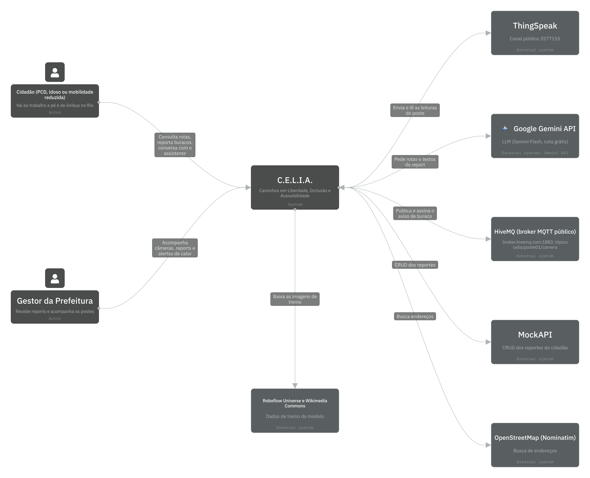
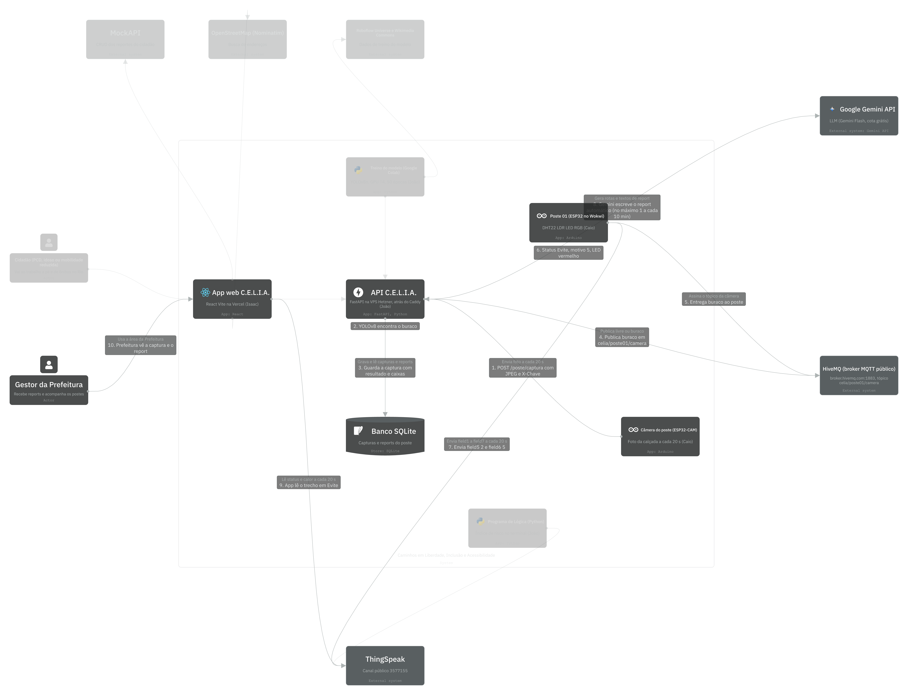
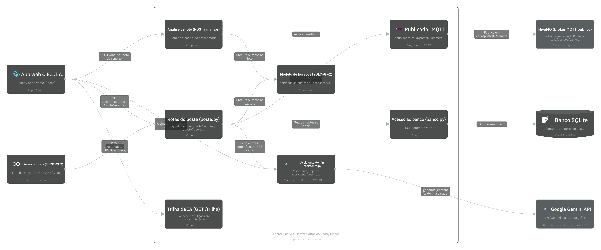
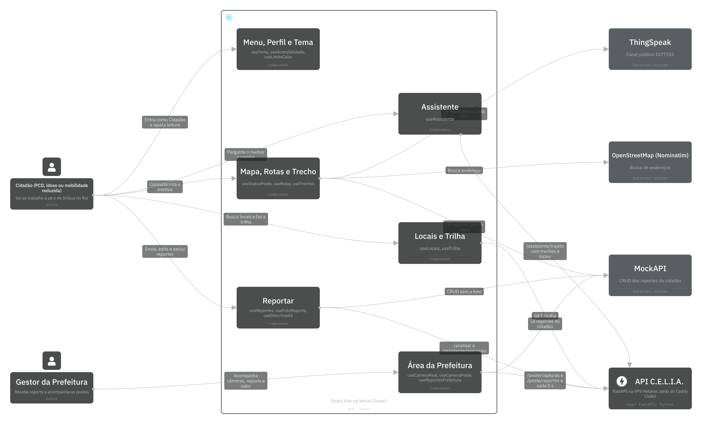
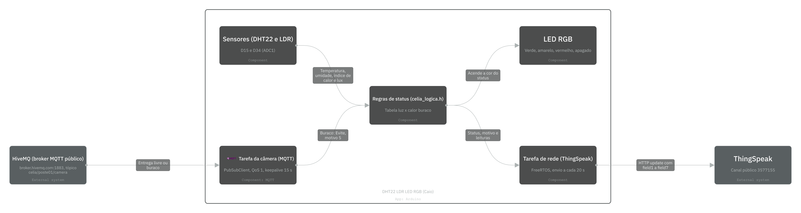

<p align="center">
  
</p>

<h3 align="center">Backend da C.E.L.I.A. · IA, LLM, visão computacional e API</h3>

<p align="center">
  
  
  
  
  
  
  
  
  
</p>

<p align="center">
  <a href="https://2-29-156-251.sslip.io/docs"><b>API no ar (documentação interativa)</b></a> ·
  <a href="https://drive.google.com/drive/folders/1YmK8JgwKLBA5SRyJwLv0eBwhsRu8y9nC">Vídeo da ESP32-CAM</a> ·
  <a href="https://celia-frontend.vercel.app">App que usa a API</a> ·
  <a href="#arquitetura">Arquitetura</a> ·
  <a href="#programa-de-lógica-computational-thinking-with-python">Programa de Lógica</a>
</p>

---

Todo o Python da C.E.L.I.A. fica nesta pasta, menos a modelagem de Cálculo (`calculo/`). A maior parte é o **backend**: uma API em FastAPI que junta a IA de visão treinada pela equipe, o assistente com o Gemini, o banco das capturas e o aviso MQTT para o poste. No fim fica o **programa de Lógica**, a entrega da disciplina Computational Thinking with Python.

| Caminho | O que é |
| --- | --- |
| `api/main.py` | API FastAPI: `/analisar`, `/trilha`, CORS, limites de upload e publicação MQTT |
| `api/assistente.py` | Assistente com o Gemini: `/assistente/trajeto` e `/assistente/descricao` |
| `api/poste.py` e `api/banco.py` | Câmera do poste (`/poste/...`) e SQLite |
| `api/modelos/buracos.pt` | Modelo de buracos v2 (o v1 fica em `buracos_v1.pt`) |
| `api/dados/trilha.json` | As 5 lições da mini trilha de IA (Capacite-se) |
| `api/ouvir_mqtt.py` | Assina o tópico MQTT para testar sem o Wokwi |
| `treino/` | Notebook do Colab, download das imagens negativas e experimento de confiança |
| `main.py` | Programa de Lógica |
| `prompts.md` | Registro dos prompts de IA desta pasta |

# Backend

## Quem chama a API

| Quem | Rota | Para quê |
| --- | --- | --- |
| App (reporte do cidadão) | `POST /analisar` | Conferir se a foto tem buraco e desenhar as caixas |
| App (reporte do cidadão) | `POST /assistente/descricao` | Sugerir a descrição para a Prefeitura, que o cidadão revisa |
| App (assistente) | `POST /assistente/trajeto` | Responder sobre o caminho com os trechos e locais que o app mandou |
| App (Capacite-se) | `GET /trilha` e `GET /trilha/{id}` | Lições da mini trilha de IA |
| ESP32-CAM do poste | `POST /poste/captura` | Mandar a foto da calçada a cada 20 s |
| App (área da Prefeitura) | `GET /poste/capturas`, `GET /poste/capturas/{id}/foto` e `GET /poste/reportes` | Últimas fotos com os buracos marcados e os reportes automáticos |
| App (ao abrir) | `GET /` | Saber se o modelo já aqueceu (`modelo_pronto`) |

**E a MockAPI?** O CRUD dos reportes do cidadão (criar, listar, editar e excluir) é feito pelo app direto na [MockAPI](https://mockapi.io), a API externa exigida em Front-end. A API em Python não guarda esses reportes: ela só analisa a foto e escreve o texto. Desde 19/11/2026 a foto não vai para a MockAPI, que é pública; ela fica só no navegador de quem enviou (RNF01).

Formato completo de cada rota (campos, erros e exemplos): [`INTEGRACAO.md`](../INTEGRACAO.md).

## Visão computacional: modelo de buracos

Nenhum sensor do poste consegue medir um buraco. Por isso a equipe treinou um modelo próprio de detecção de objetos.

| Etapa | O que a equipe fez |
| --- | --- |
| Arquitetura | YOLOv8n (Ultralytics), modelo leve, treinado a partir do `yolov8n.pt` |
| Dados | [Pothole Dataset (KugaN, v2, CC BY 4.0)](https://universe.roboflow.com/kugan/pothole-mftcc): 1.395 imagens de treino, 133 de validação e 67 de teste |
| Imagens negativas | 38 fotos de calçada portuguesa sem buraco, do Wikimedia Commons ([fontes](treino/fontes_negativas.md)), para o modelo parar de confundir os desenhos da calçada com buraco |
| Treino | Google Colab com GPU Tesla T4, 50 épocas, cerca de 20 minutos ([notebook](treino/treino_buracos.ipynb)) |
| Ajuste | Confiança mínima de 0,40, escolhida por experimento nas 67 imagens de teste: F1 de 76,2% contra 74,9% com 0,25, e 14 falsos positivos a menos ([script](treino/experimento_confianca.py)) |

| Versão | Precisão | Recall | mAP@50 | Fotos de calçada do Rio |
| --- | --- | --- | --- | --- |
| v1 (só o dataset público) | 85,7% | 74,2% | 83,6% | 4 de 6 |
| **v2 (com as 38 negativas, adotado)** | **85,0%** | **69,8%** | **79,9%** | **6 de 6** |

No asfalto do dataset o v1 vai um pouco melhor, mas só o v2 acertou todas as fotos de calçada, que é onde o projeto atua.

**Como a API usa o modelo:**
- A foto do app (JPG, PNG ou WEBP, até 5 MB) é lida **só em memória** e nunca é salva.
- A foto da ESP32-CAM (JPEG, até 1 MB, com a chave `X-Chave`) é guardada no SQLite para a Prefeitura.
- A resposta traz `resultado` (`livre` ou `buraco`) e as caixas em pixels, com a confiança de cada uma.
- O modelo roda no processador (PyTorch só de CPU) e é aquecido logo que a API liga. Na VPS, uma foto leva cerca de 0,3 s.

## LLM: assistente com o Gemini

O Gemini não vê a foto. Ele transforma dados em texto claro, e só depois que a IA de visão fez a parte dela.

| Papel | Onde | Regra |
| --- | --- | --- |
| Planejar o trajeto | `POST /assistente/trajeto` | Responde só com os trechos e locais que o app mandou. Se citar um id que não existe, a API descarta a resposta (RN06) |
| Descrever o reporte do cidadão | `POST /assistente/descricao` | Só escreve sobre buraco se a visão confirmou. O cidadão sempre revisa antes de enviar (RN07) |
| Reportar sozinho pela câmera | dentro de `POST /poste/captura` | Com buraco, escreve o reporte automático para a Prefeitura, no máximo um a cada 10 min por poste (RN08, RN09) |

| Cuidado | Como funciona |
| --- | --- |
| Privacidade (LGPD) | CPF, telefone e e-mail viram marcadores antes de o texto sair para o Google. Nada da conversa é guardado. A chave fica só no `.env` do servidor |
| Sempre responde | Tenta três modelos em sequência (`gemini-3.8-flash`, `gemini-3.5-flash` e `gemini-3.5-flash-lite`), até 20 s cada. Se os três falharem, a API responde 503 com o motivo e o app oferece um texto padrão |
| Cota grátis | Até 5 perguntas por minuto por IP (429) e até 8.000 caracteres de dados por pedido (413) |
| Não sai do assunto | O prompt de sistema limita o assistente a trajeto, calçadas, calor, banheiros, descanso e cursos de IA, e a resposta vem em JSON conferido pela API |

## ESP32-CAM, SQLite e MQTT

<p align="center">
  <a href="https://drive.google.com/drive/folders/1YmK8JgwKLBA5SRyJwLv0eBwhsRu8y9nC"><b>▶ Vídeo da ESP32-CAM sendo montada</b></a><br>
  <sub>A placa é real (AI-Thinker). O firmware está em <a href="../camera/README.md"><code>camera/</code></a>.</sub>
</p>

1. A ESP32-CAM do poste manda uma foto da calçada a cada 20 s para `POST /poste/captura`, com a chave da câmera no cabeçalho (RNF11).
2. A API guarda a captura no **SQLite** (horário, resultado, caixas e foto), com consultas parametrizadas contra SQL injection.
3. O modelo procura buracos. O resultado (`livre` ou `buraco`) vai por **MQTT** ao ESP32 do poste: broker HiveMQ, tópico `celia/poste01/camera`, QoS 1, sem retain. Só o rótulo trafega, nunca a foto.
4. Com `buraco`, o poste fica em Evite (motivo 5) e o Gemini escreve o reporte, que aparece na área da Prefeitura no app.

O broker público serve só para o protótipo. A versão real usaria um broker próprio com usuário, senha e TLS.

## VPS: como atualizar

A API roda numa VPS da Hetzner atrás do Caddy (HTTPS com Let's Encrypt), como serviço do systemd e com um usuário sem poderes de administrador. A configuração completa está no [README principal](../README.md#api-no-ar-vps).

1. Gerar o pacote só com o código: `git archive` da pasta `python-backend-IA/api`.
2. Enviar ao servidor por SSH (`scp`) e extrair na pasta da API, mantendo o `.env`, o ambiente Python, as capturas e o banco.
3. Reiniciar o serviço e conferir a rota `/`, que responde `"modelo_pronto": true`.

## Como rodar a API

Copie `api/.env.example` para `api/.env` e coloque a sua chave do Gemini ([Google AI Studio](https://aistudio.google.com)) e uma `POSTE_CHAVE` aleatória.

```powershell
cd python-backend-IA\api
python -m venv .venv
.venv\Scripts\python -m pip install -r requirements.txt
.venv\Scripts\python -m uvicorn main:app --reload
```

A documentação interativa abre em http://127.0.0.1:8000/docs. Sem a chave do Gemini, a análise de foto e a trilha funcionam; só o assistente responde 503.

**Testes:** 37 testes de falha com o `TestClient` do FastAPI (Gemini simulado, broker MQTT inexistente, banco em pasta temporária e entradas maliciosas), todos passando.

## Arquitetura

Modelo C4 feito no IcePanel, do mais geral para o mais detalhado.

<p align="center">
  <br>
  <sub><b>1. Contexto (C1):</b> o cidadão, a Prefeitura, a C.E.L.I.A. e os sistemas externos</sub>
</p>

<p align="center">
  <br>
  <sub><b>2. Contêineres (C2) com o fluxo "Câmera do poste encontra um buraco":</b> app, API, SQLite, poste, ESP32-CAM, programa de Lógica e treino</sub>
</p>

<p align="center">
  <br>
  <sub><b>3. Componentes da API (C3):</b> rotas, modelo de buracos, assistente Gemini, MQTT e banco</sub>
</p>

<p align="center">
  <br>
  <sub><b>4. Componentes do app (C3):</b> telas e custom hooks do React e as APIs que cada um chama</sub>
</p>

<p align="center">
  <br>
  <sub><b>5. Componentes do poste (C3):</b> sensores, regras de status, LED RGB e as tarefas de rede do ESP32</sub>
</p>

# Programa de Lógica (Computational Thinking with Python)

Programa de terminal que lê as leituras do poste 01 no canal público do ThingSpeak, calcula o índice de risco de cada leitura e mostra a mesma faixa que o cidadão vê no app: **Acessível**, **Atenção** ou **Evite**.

- Canal público: https://thingspeak.mathworks.com/channels/3577155
- Rastreabilidade: HU-02, RF16, RN01

## Como rodar

```
cd python-backend-IA
pip install -r requirements.txt
python main.py
```

Menu (repete até escolher Sair):

1. Buscar leituras do poste (ThingSpeak; se falhar, usa o `backup.json`)
2. Ver leituras e faixas
3. Ver resumo: contagem por faixa, tendência e maior episódio em Evite
4. Salvar `historico.json` (sem repetir leituras) e `relatorio.csv`
0. Sair

## Medidas e índice de risco

O programa usa 2 campos do canal:

| Medida | Campo | Nível 0 | Nível 100 |
| --- | --- | --- | --- |
| Índice de calor (°C) | field3 | 32 °C | 41 °C |
| Luminosidade (lux), medida pelo LDR | field7 | 10 lux ou mais | 0 lux (invertida) |

Fórmulas (a configuração fica no dicionário `CONFIG`):

```
nivel = (valor - min) / (max - min) * 100      (limitado entre 0 e 100)
risco = 0,5 * nivel_calor + 0,5 * nivel_luz
```

**Por que esses valores:** são os mesmos limites do firmware do poste (`edge/celia_logica.h`), para o programa, o ESP32 e o app classificarem do mesmo jeito.

- **Calor:** 32 °C é onde o poste passa a mostrar Atenção, e 41 °C é onde passa a mostrar Evite. O índice de calor é calculado no ESP32 a partir da temperatura e da umidade (fórmula de Rothfusz, NOAA); ele representa a sensação térmica no corpo.
- **Luz:** abaixo de 10 lux o poste considera a rua escura. No escuro a pessoa não vê buraco, degrau ou desnível na calçada. No `CONFIG` a luz fica com mínimo 0 e máximo 10 e a marca `"invertida": True`: quanto menos luz, maior o risco (o nível vira `100 - nível`). Ex.: 5 lux dá nível 50; 10 lux ou mais dá nível 0.
- **Pesos iguais (0,5 e 0,5):** calor forte e rua escura atrapalham o trajeto do mesmo jeito.
- **Regra do sol:** o poste deixa o trecho em Evite quando há sol direto (25.000 lux ou mais) junto com calor (índice de 32 °C ou mais): calçada sem sombra no calor. A fórmula linear só mede o escuro e não enxerga o sol, então o programa aplica essa regra depois da fórmula (função `aplicar_regra_sol`). O sol sozinho não piora o trecho, igual ao poste.

Desde 18/11/2026 o poste mede a luz (LDR, field7) no lugar da distância na calçada (HC-SR04, field4). O buraco na calçada é visto pela câmera com o modelo de IA da equipe.

Faixas do risco:

| Risco | Faixa | Cor (a mesma do app) |
| --- | --- | --- |
| 0 | ✓ Acessível | verde #1E8E3E |
| acima de 0 e abaixo de 50 | ! Atenção | laranja #B26A00 |
| 50 ou mais | ✕ Evite | vermelho #C62828 |

Nos 4 cenários do roteiro do poste (500 lux e 26 °C; 5 lux e 26 °C; 500 lux e 33 °C; 50.000 lux e 33 °C) o programa dá a mesma faixa que o LED: Acessível, Atenção, Atenção e Evite.

Diferença conhecida: o índice soma os problemas. Com uma medida no extremo (0 lux, escuro total, ou índice de calor de 41 °C ou mais), ou com as duas ruins ao mesmo tempo, o risco chega a 50 e o programa mostra Evite. O poste, nesses casos, mostra Atenção. A cor que o cidadão vê no app vem do status do poste (field5).

Configuração inválida (pesos que não somam 1, mínimo maior ou igual ao máximo, cortes fora de ordem, faixa sem aviso) dispara `ValueError`.

**Avisos:** cada faixa tem um aviso no `CONFIG`, com o mesmo texto que o app mostra. O resumo (opção 3) mostra a faixa da leitura mais recente e o aviso dela.

## Outras regras

- Leituras guardadas como dicionários `{id, horario, medidas, risco, faixa}`; o `id` é o `entry_id` do ThingSpeak.
- Campo vazio (sensor falhou) ou valor absurdo (registros antigos de teste) é descartado. Os registros 1 a 39 do canal são da versão antiga do poste (distância no field4, sem luz) e ficam de fora.
- Tendência: **PIORANDO** quando o risco sobe 3 vezes seguidas nas últimas leituras.
- Maior episódio em Evite: a maior sequência seguida de leituras em Evite.
- `historico.json` não repete leituras: os `entry_id` já salvos ficam num `set`.
- Plano B: toda busca que dá certo salva os dados em `backup.json`; se a internet ou o ThingSpeak falharem (timeout, status diferente de 200 ou `RequestException`), o programa usa esse arquivo.
- Nada derruba o programa:
    - **rede:** sem internet, timeout, status diferente de 200 ou resposta em formato estranho (ex.: `-1` de canal privado), usa o `backup.json`;
    - **arquivo:** `backup.json` ausente, corrompido ou com registros estranhos vira lista vazia (ou pula o registro) com aviso; `historico.json` corrompido é guardado como `historico_corrompido.json` e um novo começa; erro ao gravar (ex.: `relatorio.csv` aberto no Excel) mostra aviso;
    - **entrada:** opção inválida pede de novo, e Ctrl+C (no menu ou durante a busca) sai com "Até logo!" sem erro.

## Limitação

A foto da calçada analisada pela IA (buraco) entra no status do poste (field5 e field6), mas não entra neste índice: aqui só entram as duas medidas dos sensores (calor e luz).

## Print

(adicionar print do programa rodando)

## Uso de IA

Prompts em [prompts.md](prompts.md).
